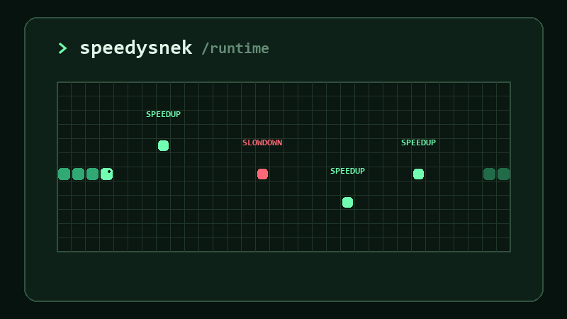

# speedy-snek

Because Python doesn’t have to be a slow snek 🐍



Need more speed? Just `@snekit`.

SpeedySnek is a small educational JIT compiler experiment for CPython 3.14.
**`@snekit` performs experimental native compilation**: a decorated
function in the supported integer subset (arithmetic, local variables,
simple `if`/`else` and one `while` loop or `for` loop over `range(n)`) is
compiled once,
after a short warmup, to signed 64-bit machine code with Cranelift.
Everything else, including every unsupported function, argument or call,
safely falls back to normal Python.

The project has a reproducible [benchmark suite](benchmarks/README.md)
measuring where the time goes. **The optimizer is experimental, and for
small functions it still makes calls slower, not faster.** On the
committed baseline machine, a warmed `@snekit` call has a fixed cost of
about 500 ns. That makes it 7.7× slower than plain Python for a
one-operation function and 1.4× slower at 20 operations. It is faster from
about 30 operations up: 0.61× at 50, 0.16× at 250. See
[Benchmarks](#benchmarks) and [`benchmarks/RESULTS.md`](benchmarks/RESULTS.md).

## Installing a prebuilt wheel

SpeedySnek is **not on PyPI yet**, so `pip install speedysnek` does not
work. Prebuilt wheels can be built on demand by a manual GitHub Actions
workflow and downloaded from it. A prebuilt wheel contains the compiled
extension, so it needs **no Rust, Cargo, Visual Studio Build Tools or any
other C/C++ compiler**.

A wheel only installs on the exact CPython version, operating system and
architecture it was built for. Wheels are built only for standard
(GIL-enabled) **CPython 3.14**; other Python versions and the free-threaded
build (`python3.14t`) are not supported:

| Platform | Artifact to download | Wheel tag |
| --- | --- | --- |
| Windows x86_64 (64-bit) | `speedysnek-cp314-windows-x86_64` | `cp314-cp314-win_amd64` |
| Linux x86_64, glibc 2.28 or newer (not musl/Alpine) | `speedysnek-cp314-linux-x86_64` | `cp314-cp314-manylinux_2_28_x86_64` |
| macOS 11 or newer on Apple silicon (arm64) | `speedysnek-cp314-macos-arm64` | `cp314-cp314-macosx_11_0_arm64` |

If pip says the wheel "is not a supported wheel on this platform", the
Python version, OS or architecture does not match.

**Run the workflow.** On GitHub, open the repository's **Actions** tab,
select **Build wheels**, click **Run workflow**, pick a branch (usually
`main`) and confirm. This needs write access to the repository. Each job
builds one wheel, installs it into a fresh virtual environment and checks
that `@snekit` compiles and runs native code; only wheels that pass are
uploaded.

**Download.** When the run has finished, open it and download the
artifact for your platform from the **Artifacts** section at the bottom of
the run's summary page (you must be signed in to GitHub). GitHub delivers
each artifact as a ZIP file containing one `.whl` file. Artifacts expire
after the repository's retention period (90 days by default).

**Install on Windows (PowerShell, CPython 3.14 x64).** Check that
`py -3.14` is 64-bit CPython 3.14: the following prints `AMD64`.

```powershell
py -3.14 -c "import platform; print(platform.machine())"
Expand-Archive .\speedysnek-cp314-windows-x86_64.zip -DestinationPath .\speedysnek-wheel
Get-ChildItem .\speedysnek-wheel\*.whl       # shows the wheel's actual file name
py -3.14 -m venv .venv
.\.venv\Scripts\Activate.ps1
cd .\speedysnek-wheel
python -m pip install .\ACTUAL_WHEEL_FILENAME.whl
```

`ACTUAL_WHEEL_FILENAME.whl` is a **placeholder**: use the file name
`Get-ChildItem` printed, which looks like
`speedysnek-0.1.0-cp314-cp314-win_amd64.whl` (illustrative only; the
version may differ). If PowerShell refuses to run `Activate.ps1`, run
`Set-ExecutionPolicy -Scope Process RemoteSigned` first, or skip activation
and use `.\.venv\Scripts\python.exe` instead of `python`.

**Install on Linux or macOS.** Some macOS browsers extract the ZIP
automatically; in that case skip `unzip`.

```sh
unzip speedysnek-cp314-linux-x86_64.zip -d speedysnek-wheel   # or ...-macos-arm64.zip
python3.14 -m venv .venv
source .venv/bin/activate
python -m pip install speedysnek-wheel/*.whl
```

**Try it.**

```python
from speedysnek import snekit

@snekit
def expression(a, b):
    return (a + b) * 2

print([expression(10, 20) for _ in range(10)][-1])  # 60, compiled after warmup
print(expression(2**62, 2**62))                      # 18446744073709551616, by Python
```

## Usage

```python
from speedysnek import snekit

@snekit
def expression(a, b):
    return (a + b) * 2

for _ in range(100):
    result = expression(10, 20)   # 60

expression(2**62, 2**62)          # 18446744073709551616, computed by Python
expression.call_count             # 101
```

Functions can use local variables, too. Each assigned value is computed
once, and reading a variable again reuses it:

```python
from speedysnek import snekit

@snekit
def calculate_score(wins, draws, penalties):
    points = wins * 3 + draws
    deduction = penalties * 2
    result = points - deduction
    return result

for _ in range(100):
    score = calculate_score(10, 4, 3)   # 28, native after warmup
```

Updating a variable in place with `+=`, `-=` or `*=` works the same way:

```python
@snekit
def calculate_score(wins, draws, penalties):
    points = wins * 3
    points += draws
    points -= penalties * 2
    return points
```

`if` statements work too, when the condition is one comparison of
integers. Only the branch that is selected runs:

```python
@snekit
def calculate_score(wins, penalties):
    score = wins * 3 - penalties
    if score < 0:
        score = 0
    else:
        score += 5
    return score
```

A `while` loop whose condition is one integer comparison runs entirely
inside one native call:

```python
@snekit
def sum_squares(n):
    total = 0
    i = 0
    while i < n:
        total += i * i
        i += 1
    return total

sum_squares(10_000)   # 333283335000, native after warmup
```

A `for` loop over `range(n)` works the same way:

```python
@snekit
def conditional_sum(n, cutoff):
    total = 0
    for i in range(n):
        if i < cutoff:
            total += i
        else:
            total += i * 2
    return total

conditional_sum(10_000, 5_000)   # 87492500, native after warmup
```

Only the builtin `range` with exactly one argument is supported:
`range(start, stop)`, `range(start, stop, step)`, keyword arguments and
every other iterable run as plain Python. The compiled code relies on
`range` being the builtin, so `@snekit` checks that before compiling and
watches the function's globals and builtins afterwards: if `range` is
shadowed, replaced or deleted later, the next call runs as plain Python
(with whatever `range` now is), and so does every call after it. See
[`docs/for-range.md`](docs/for-range.md).

Native code holds the GIL, so one call may run at most 1,000,000 loop
iterations natively, `while` or `for`. A call that needs more is restarted
from the beginning in plain Python, so it does that work twice; nothing
about the result changes. See [`docs/loops.md`](docs/loops.md).

What compiles today:

- positional `int` arguments and `int` constants;
- `+`, `-` and `*`;
- assignments to local variables (including reassigning an argument), and
  `+=`, `-=` and `*=` on local variables and arguments;
- `if`, `if`/`else` and `elif`, nested or one after another, whose
  condition is a single `<`, `<=`, `>`, `>=`, `==` or `!=` between integer
  expressions;
- one loop per function, not nested in another loop, with any of the
  above in its body, before it and after it: either a `while` loop with
  such a condition, or a `for` loop over the builtin `range` with one
  argument, an integer expression of the above (`for i in range(n * 2 -
  m):`), assigning one local variable;
- `return` of an integer expression at the end of every path.

A variable assigned in only some branches can be read after them only if
it was assigned before the `if`; otherwise the function runs as plain
Python, which raises `UnboundLocalError` where Python would.

Still running as plain Python: `for` loops over anything but `range(n)`
(including `range(start, stop)`, `range(start, stop, step)`, `range(stop=n)`
and `for a, b in ...`), nested or several loops (two `for` loops, or a
`for` and a `while`), `break`, `return` inside a loop, `while True:`,
reading a `for` loop's variable after the loop when an empty range would
leave it unassigned, `and`, `or` and
`not` in conditions (except `and` between comparisons, which CPython
compiles exactly like nested `if` statements), chained comparisons
(`a < b < c`), conditions that are not a comparison (`if a:`, `is`, `in`),
comparison results used as values (`x = a < b`, `return a < b`),
conditional expressions inside a larger expression, function calls,
globals, other augmented operators (`/=`, `//=`, `%=`, …), attribute or
item updates (`obj.x += 1`, `items[0] += 1`), tuple assignment, `try` and
`with`, and everything else. Because SpeedySnek reads CPython's bytecode,
not source, a `return` inside a branch and a conditional expression such
as `return a if a < b else b` are compiled when CPython emits them the
same way as an `if` statement with a `return` in each branch. Likewise, a
`continue` and a `while`/`else` or `for`/`else` without `break` compile,
because their bytecode is identical to supported `if`/`else` forms.

`@jit` is the descriptive, backwards-compatible name for the same
decorator: `speedysnek.jit is speedysnek.snekit`, so existing
`from speedysnek import jit` code keeps working unchanged. New code should
use `@snekit`.

### Guarantees

`@snekit` must never change what a call returns or raises. It wraps the
function with `functools.wraps` (so `__name__`, `__qualname__`, `__doc__`,
`__module__`, `__annotations__` and `__wrapped__` are preserved, and methods
bind normally) and exposes `call_count`: the number of times the wrapper has
been called, including calls that raised. It is an exact `int` with no
upper bound, its increments are atomic, and it can be set to any integer
(anything `operator.index` accepts).

The wrapper is a native callable object, not a Python function: it has no
`__code__`, `__defaults__` or `__globals__` of its own,
`inspect.isfunction` is false for it, and tracebacks and profilers show no
wrapper frame. The full list of differences is in
[`benchmarks/experiments/native_wrapper.md`](benchmarks/experiments/native_wrapper.md#observable-differences).

### Runtime pipeline

```
decorated function
    → warmup
    → frontend analysis
    → normalized IR
    → cached Cranelift i64 specialization
    → native execution when guards pass
    → original CPython function otherwise
```

Once compiled, a call that fits runs no Python code at all: the wrapper
itself is written in Rust.

```
@snekit wrapper (Rust)
    → native fast path (Rust)
        → validate every argument once: exact int, inside signed 64-bit
        → run the machine code, which checks every operation for overflow
        → return the result int, or None for a guard miss
    → original function, only if the result was None
```

Each decorated function has its own small state machine:

- **Cold.** The first 8 calls run the original function. Nothing is
  analyzed, and the function is never run just to collect types.
- On the **next call**, the function is analyzed and compiled, **once**.
  Compilation modules are imported only at this point, so a plain
  `import speedysnek` stays cheap.
- **Compiled.** The native code is cached and reused. A call runs natively
  only if it passes **positional arguments only**, exactly as many as the
  function has parameters, and the function's `__code__` is still the code
  object that was compiled. Calls with keyword arguments, omitted default
  arguments, or the wrong number of arguments run the original function, so
  CPython produces its usual results and error messages.
- If the native guards reject a call (`bool`, `int` subclasses, `float`,
  `str` or any non-`int` argument, an `int` outside the signed 64-bit
  range, a `+`, `-` or `*` that would overflow, even in an intermediate
  value, or a loop needing more than 1,000,000 iterations), **that call**
  runs the original function with the original arguments, which computes
  Python's exact arbitrary-precision result. The native code stays cached
  for later calls. Such a guard miss is expected, so it is reported with a cheap
  `None` sentinel, not an exception, and the guards never run any of the
  argument's Python code (no `__index__`, `__int__`, `__repr__` or
  metaclass hooks). Only an unexpected error from the native code
  disables the specialization.
- **Disabled.** If the function is outside the supported subset (`for`
  loops over anything but `range(n)`, nested loops, conditions other than
  one integer comparison, calls, globals, closures, generators, async
  functions, keyword arguments, a variable that may be read before it is
  assigned, …), the backend cannot compile it, or the compiler fails
  unexpectedly, it is never compiled again and every call runs the
  original function. A `for` loop over a `range` that is not the builtin
  when the function is compiled, or whose globals or builtins cannot be
  checked without running Python code (a dict subclass, a key that is not
  a `str`), is disabled the same way. Replacing the function's `__code__`,
  or changing what `range` means for it, after compilation also disables
  the cached code; stale machine code is never run, and there is no
  recompilation yet.

Whenever native execution does not apply, the original function is called
exactly once, and its result or exception is passed through unchanged.

Native Rust code lives in the private `speedysnek._native` extension module.

## Compiler pipeline

```
Python function
    → CPython 3.14 bytecode frontend
    → normalized IR
    → reference interpreter (test oracle) or Cranelift i64 backend (@snekit)
```

The private `speedysnek._frontend` package implements the first two
arrows. It reads a function's bytecode with the public `dis` module, without
calling the function, and normalizes it into a tiny stack-machine
instruction set:

```python
from speedysnek._frontend import analyze

def add(a, b):
    return a + b

for instruction in analyze(add).instructions:
    print(instruction)
# LOAD_ARG 0
# LOAD_ARG 1
# ADD
# RETURN
```

Local variables become numbered local slots: `STORE_LOCAL n` and
`LOAD_LOCAL n`. `LOAD_ARG n` always means the argument as passed, and an
argument that the function reassigns gets a local slot of its own. An `if`
becomes a comparison such as `LESS_THAN` followed by `JUMP_IF_FALSE t`,
where `t` is the index of a later instruction. The details are in
`python/speedysnek/_frontend/ir.py` and `cpython314.py`, and the design of
conditionals in [`docs/conditionals.md`](docs/conditionals.md).

Current status:

- Only **integer arithmetic with `if`/`else` and one loop** is
  supported: positional arguments, `int` constants, `+`, `-`, `*`, plain
  assignments to local variables (`x = a + b`, including reassigning an
  argument), `+=`, `-=` and `*=` on local variables and arguments, `if`
  statements, one `while` loop on one integer comparison or one `for`
  loop over `range(n)`, and `return`.
  An augmented assignment becomes the same `ADD`, `SUBTRACT` or `MULTIPLY`
  followed by `STORE_LOCAL` as the equivalent `x = x + …`: native code only
  ever sees exact `int`s, which have no in-place operators, and any other
  value falls back to Python, which calls its `__iadd__`, `__isub__` or
  `__imul__` as usual.
- **One loop at most**: a `while` loop becomes a test, a body and a
  `JUMP` back to the test, the only backward jump the IR allows. A `for`
  loop over `range(n)` becomes the same loop over two hidden local slots,
  the bound and a counter (the iterator never reaches the IR), and the
  analysis records that it assumes the builtin `range`, which `@snekit`
  guards ([`docs/for-range.md`](docs/for-range.md)). Other `for` loops,
  nested loops and loops left other than by their condition are rejected.
  Conditions must be one `COMPARE_OP` directly consumed by
  `POP_JUMP_IF_FALSE` (or, at the end of a loop body, `POP_JUMP_IF_TRUE`
  over the backward jump); `or`, `not`, truthiness, `is`, `in`, chained
  comparisons and comparison results used as values are rejected. The
  design is in [`docs/loops.md`](docs/loops.md).
- Anything else (division, calls, globals, attributes, other augmented
  operators, augmented assignment to attributes, items or globals, tuple
  or chained assignment, `del`, closures, generators, async functions,
  non-`int` constants, …) is rejected with a
  machine-readable reason and, where applicable, the offending CPython
  opcode and bytecode offset. So is reading a local variable that may not
  be assigned yet; the original function then raises its usual
  `UnboundLocalError`.
- `@snekit` runs the frontend once per hot function. It is not public API.
- All CPython 3.14-specific handling lives in
  `python/speedysnek/_frontend/cpython314.py`.

### Reference interpreter

The private `speedysnek._interpreter` module executes normalized
instructions directly, without the original function:

```python
from speedysnek._frontend import Instruction, Op
from speedysnek._interpreter import execute

program = (
    Instruction(Op.LOAD_ARG, 0),
    Instruction(Op.LOAD_CONST, 2),
    Instruction(Op.MULTIPLY),
    Instruction(Op.RETURN),
)
execute(program, args=(5,))  # 10
```

- It is a **correctness oracle**, not a performance optimization: the native
  backend must produce exactly the same results.
- It executes only **exact-`int` arithmetic and comparisons**, following
  the branch each comparison selects. Every argument the program reads,
  on any path, must satisfy `type(value) is int` (so `bool`, `float`,
  `str` and `int` subclasses are rejected); otherwise it raises
  `GuardFailure`.
- The whole program is validated before it runs. Malformed instructions
  (empty program, stack underflow, a local slot read before it is stored
  on every path, a backward jump that is not one loop's backedge, an
  out-of-range jump, unreachable code, a path without `RETURN`, leftover
  stack values, …) raise `InvalidProgramError`, which means a compiler
  bug.
- Arithmetic uses Python `int`, so **arbitrary precision is intentional**:
  `2**63 + 1` is not wrapped to a 64-bit value.
- `@snekit` never uses it; it is used by the tests and is not public API.

### Cranelift i64 backend

The private `speedysnek._compiler` module compiles normalized instructions
into host machine code with [Cranelift](https://cranelift.dev/), working on
signed 64-bit integers:

```python
from speedysnek._compiler import compile_i64
from speedysnek._frontend import analyze

def expression(a, b):
    return (a + b) * 2

compiled = compile_i64(analyze(expression).instructions)
compiled(10, 20)  # 60, computed by generated machine code
```

- It is **private and experimental**. `@snekit` uses it to compile hot
  functions.
- It supports only the current subset (`+`, `-`, `*` on arguments,
  constants and local variables, and signed comparisons that steer
  branches and one loop). Local slots are Cranelift variables: a slot
  names a value that was already computed, so an assignment copies
  nothing at run time and reading a local twice reuses one computation;
  where branches join, or a loop's backward jumps meet its entry, SSA
  block parameters carry each path's value.
- It never returns a wrapped 64-bit value. Constants outside the signed
  64-bit range are rejected at compile time (`UnsupportedProgramError`).
  At call time, arguments that are not exact `int`s in that range, a wrong
  number of arguments, or any `+`, `-` or `*` that overflows are a guard
  miss, including one whose result is later overwritten or never read.
  Only operations on the branch that runs are checked: an overflow that
  would happen only on a branch not taken is not a guard miss.
- A compiled program has two entry points:
  - `compiled(*args)`, the **diagnostic** path, raises
    `NativeGuardFailure` with the exact reason for a miss (wrong arity, not
    an exact `int`, outside i64, or overflow at a given instruction). It
    checks the arguments in Python, then again in Rust. Tests and direct
    users of the compiler rely on it.
  - `compiled.fast_call(args)`, the **fast** path, checks the arguments
    once, in Rust, and returns the result `int`, or `None` for any miss,
    without raising and without saying why. `@snekit`'s native wrapper
    runs the same Rust code directly.
- Every generated function has the same internal ABI,
  `status = f(args_ptr, args_len, result_ptr)`, with overflow handled by
  explicit branches rather than traps.
- Native code beats Python by a wide margin per operation, but each call
  still has a fixed cost; see [Benchmarks](#benchmarks).

## Benchmarks

[`benchmarks/`](benchmarks) is a [pyperf](https://pyperf.readthedocs.io/)
suite. It times the plain function, the warmed `@snekit` wrapper and the
native fast path called from Python, and separately the diagnostic `CompiledI64`
path. It also measures fallback overhead, compilation and warmup cost,
and cold import. The benchmarks are optional, and pyperf is not installed
for ordinary users.

```sh
python -m pip install maturin
python -m pip install -e ".[tests,benchmarks]"   # builds a release extension
maturin develop --release                         # after every Rust change

mkdir -p results
python benchmarks/bench_runtime.py     -o results/runtime.json
python benchmarks/bench_compilation.py -o results/compilation.json
python benchmarks/report.py results/runtime.json results/compilation.json \
    -o results/RESULTS.md
```

> **Debug builds are not representative.** A plain `maturin develop`
> builds an unoptimized extension that is many times slower; the scripts
> warn about it and the report records the build mode.

[`benchmarks/RESULTS.md`](benchmarks/RESULTS.md) is one committed baseline
from one machine, not a universal claim. It was measured on a shared
4-vCPU KVM guest with CPython 3.14.6 and a release build; most benchmarks
show 15–25% noise. That machine ran plain Python much slower than during
the previous baseline, so the previous code was measured again in the
same session as a controlled comparison. On that machine:

- Removing the Python guard layer made a warmed `@snekit` call **about
  2.5–3× cheaper** than the previous code: 1,446 → 544 ns at 1 operation
  and 1,741 → 725 ns at 250. Its fixed cost fell from about 1.45 µs to
  about 500 ns.
- Warmed `@snekit` is now **faster than plain Python from about 30
  operations** (0.61× at 50, 0.36× at 100, 0.16× at 250). It is still
  slower for smaller functions: 7.7× at 1 operation, 3.6× at 5 and 1.4× at
  20. The previous code crossed over at about 94 operations in the same
  session (134 in the previous baseline).
- Three workloads now break even, after about 7,200 (`ops_050`), 4,500
  (`ops_100`) and 3,200 (`ops_250`) calls; previously only `ops_250` did.
- A guard miss (`float`, an `int` outside i64, overflow) now costs 430–515
  ns over plain Python instead of 1.9–2.8 µs, because it no longer raises
  and catches an exception. Paths that skip native code are unchanged
  (315–525 ns extra).
- The **decorator wrapper itself** is now the largest cost: 340–430 ns,
  56–78% of a warmed call. The native fast call costs about 112 ns plus
  0.84 ns per operation (Python: about 18 ns per operation on this
  machine).

The [interpretation](benchmarks/RESULTS.md#interpretation) recommends
making the wrapper cheaper next. Since that baseline, the wrapper has moved
into Rust: a short A/B run measured warmed calls 0.58–0.66× as long as with
the Python wrapper (about 90–100 ns less per call) and guard misses about
0.55×, with no slower case
([experiment](benchmarks/experiments/native_wrapper.md)). The committed
baseline predates this change.
A short [measurement of functions with `if`/`else`](benchmarks/experiments/conditionals.md)
found them running natively at the same fixed cost per call as
straight-line functions of similar size, so small ones are still about 2×
slower than plain Python.
A short [measurement of `while` loops](benchmarks/experiments/loops.md)
found `sum_squares` and `conditional_sum` 2.2–2.8× faster than plain
Python at 10 iterations and 20–30× faster from 1,000 iterations up, while
a call needing more than the 1,000,000-iteration budget was about 3%
slower, because its first million iterations run twice.
A short [measurement of `for` loops over `range(n)`](benchmarks/experiments/for_range.md)
found them as fast as the equivalent warmed `while` loops (for
`conditional_sum` 15–25% faster from 100 iterations up): 1.6–2.0× faster
than plain Python at 10 iterations and 21–24× faster at 10,000. The range
guard took under 10 µs once, at compilation, and no measurable time on
calls of functions that do not use `range`.

[`benchmarks/README.md`](benchmarks/README.md) explains the methodology,
how to get more stable numbers, and how to update the baseline.

## Development

Building from source requires CPython 3.14 and a Rust toolchain (on
Windows also the Visual Studio C++ Build Tools). To use SpeedySnek without
them, install a [prebuilt wheel](#installing-a-prebuilt-wheel).

```sh
python -m venv .venv && source .venv/bin/activate
python -m pip install maturin
python -m pip install -e ".[tests,benchmarks]"
maturin develop --release
pytest
```

`pytest` runs the compiler tests in `python/tests/` and the benchmark
correctness tests in `benchmarks/tests/`. No test asserts a timing.
